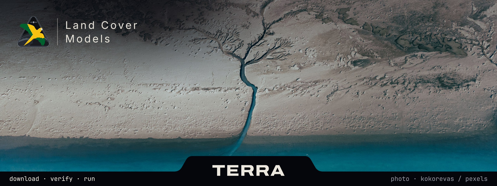

  

# TERRA models

Trained land-cover classifiers for [TERRA](https://github.com/rexionmars/TERRA),
published as model packages. TERRA lists them on its **Models** screen from
`catalog.json` in this repository, and installs a package only after its zip
matches the SHA-256 the catalogue gives for it.

| Model | Packaged by | Package | Size | Needs | Zip SHA-256 |
|---|---|---|---|---|---|
| Random Forest 1.0.0 | João Leonardi | [`spectral-1.0.0.zip`](https://github.com/rexionmars/TERRA-models/releases/tag/spectral-1.0.0) | 14.8 MB | | `a07eda60aa11a673e3385bc662f97469cbcb6ab50bc64c9b0bea9b58ce039ffc` |
| Temporal Transformer 1.0.0 | João Leonardi | [`temporal_transformer-1.0.0.zip`](https://github.com/rexionmars/TERRA-models/releases/tag/temporal_transformer-1.0.0) | 1.7 MB | `torch` | `7334541ef48908d0418ad23675f259e177da2556e1f3d965b7f3a6f4b3fe2819` |

Both classify Sentinel-2 L2A series into the MapBiomas classes 3, 21, 25, 39 and
41, and were fitted for western Paraná. Each package's `model.json` states what
the model reads, how it works, how it was evaluated and its limits; TERRA shows
the same on the model's page.

## Installing

In TERRA, open **Models**, choose a model and **Download and install**. A
package downloaded by hand installs through **Import a package**.

## Format

A package is a flat zip: `model.json` and the files it names, each with its
SHA-256 and size. TERRA checks every file against the manifest when it installs
the package and again before every run, because the weights are pickles and
loading one runs code. The format is described in TERRA's
[docs/ARCHITECTURE.md](https://github.com/rexionmars/TERRA/blob/main/docs/ARCHITECTURE.md#model-packages).

`catalog.json` and the zips are written by TERRA's `scripts/package_models.py`,
which makes reproducible zips; neither is edited by hand.

## Licence

The weights are released under the MIT licence, in [LICENSE](LICENSE). They were
trained against land-cover maps of the [MapBiomas](https://brasil.mapbiomas.org)
project, which are published under CC BY 4.0. Each card picture is credited in
its package's `model.json`.

The banner is not covered by the MIT licence. Its photograph is by kokorevas on
[Pexels](https://www.pexels.com/photo/28766209/), used under the
[Pexels licence](https://www.pexels.com/license/). The golden parakeet
(*Guaruba guarouba*) in TERRA's mark is traced from a
[photograph by Christoph Moning](https://commons.wikimedia.org/wiki/File:Guaruba_guarouba_442618436.jpg),
licensed [CC BY 4.0](https://creativecommons.org/licenses/by/4.0/).
