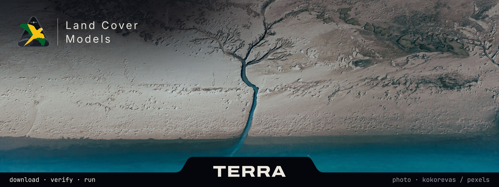

  

# TERRA models

Trained models for [TERRA](https://github.com/rexionmars/TERRA), published as
model packages. TERRA lists them on its **Models** screen from
`catalog.json` in this repository, and installs a package only after its zip
matches the SHA-256 the catalogue gives for it.

| Model | Packaged by | Package | Size | Needs | Zip SHA-256 |
|---|---|---|---|---|---|
| Random Forest 1.0.1 | João Leonardi | [`spectral-1.0.1.zip`](https://github.com/rexionmars/TERRA-models/releases/tag/spectral-1.0.1) | 14.9 MB | | `2b45bb9937c8ed48139fd11b5469888f5963ba9c5fcaa995bbc1df284a519792` |
| Temporal Transformer 1.0.1 | João Leonardi | [`temporal_transformer-1.0.1.zip`](https://github.com/rexionmars/TERRA-models/releases/tag/temporal_transformer-1.0.1) | 1.7 MB | `torch` | `710826c3ab48b042d0de669ec1e421d45e0c2e9730ca5ac7bce57809daaab4cc` |
| Gaussian Process 0.1.0 | João Leonardi | [`gp_series-0.1.0.zip`](https://github.com/rexionmars/TERRA-models/releases/tag/gp_series-0.1.0) | 30 kB | | `890b0b900b9ebe82137e49366e1eefa1c5feae202dfab2156c042f6829941a5d` |
| Observation noise 0.1.0 | João Leonardi | [`observation_noise-0.1.0.zip`](https://github.com/rexionmars/TERRA-models/releases/tag/observation_noise-0.1.0) | 14 kB | | `f5308b1285f6acfa4f04db7d75deb38a60dd8fb48beed38f1f5ba1731b909031` |
| Transient excursions 0.1.0 | João Leonardi | [`transient_excursions-0.1.0.zip`](https://github.com/rexionmars/TERRA-models/releases/tag/transient_excursions-0.1.0) | 11 kB | | `82d97a22fa924e350a226580174e900fc93001047e56ee76137ec99e6572f92c` |

The Random Forest and the Temporal Transformer classify Sentinel-2 L2A series
into the MapBiomas classes 3, 21, 25, 39 and 41, and were fitted for western
Paraná. The Gaussian Process fits a smooth trajectory to a field's Sentinel-2
series and gives its 95 % interval; TERRA runs it as the NDVI trajectory
product. It was calibrated on fields in Bahia, Mato Grosso and Paraná, and
needs a TERRA built from `main` since
[#111](https://github.com/rexionmars/TERRA/pull/111).

Observation noise and Transient excursions judge the dates of that series
rather than fit it, and TERRA runs them beside the NDVI trajectory once
installed. Observation noise gives each date its noise, from the share of the
field that was clear on it, and was measured in Mato Grosso only. Transient
excursions marks the dates briefly brighter in blue, or darker in blue and near
infrared, than the 15 days either side: haze, a cloud edge, a cloud shadow.
Both need a TERRA that knows their families, `noise_table` and
`excursion_detector`, which is not on `main` yet.

Each package's `model.json` states what the model reads, how it works, how it
was evaluated and its limits; TERRA shows the same on the model's page.

## Installing

In TERRA, open **Models**, choose a model and **Download and install**. A
package downloaded by hand installs through **Import a package**.

## Format

A package is a flat zip: `model.json` and the files it names, each with its
SHA-256 and size. TERRA checks every file against the manifest when it installs
the package and again before every run, because the land-cover weights are
pickles and loading one runs code. The Gaussian Process, Observation noise and
Transient excursions packages hold only JSON besides their picture. The format is described in TERRA's
[docs/ARCHITECTURE.md](https://github.com/rexionmars/TERRA/blob/main/docs/ARCHITECTURE.md#model-packages).

`catalog.json` and the zips are written by TERRA's `scripts/package_models.py`,
which makes reproducible zips; neither is edited by hand.

## Licence

The weights and parameters are released under the MIT licence, in
[LICENSE](LICENSE). The two land-cover models were trained against land-cover
maps of the [MapBiomas](https://brasil.mapbiomas.org) project, which are
published under CC BY 4.0. Each card picture is credited in
its package's `model.json`; the pictures of the 1.0.1 packages show Esri World
Imagery, which the MIT licence does not cover. The picture of the Gaussian
Process package is CC BY 4.0 and contains modified Copernicus Sentinel data
2020–2021; those of Observation noise and Transient excursions are CC BY 4.0
and contain modified Copernicus Sentinel data 2024–2025.

The banner is not covered by the MIT licence. Its photograph is by kokorevas on
[Pexels](https://www.pexels.com/photo/28766209/), used under the
[Pexels licence](https://www.pexels.com/license/). The golden parakeet
(*Guaruba guarouba*) in TERRA's mark is traced from a
[photograph by Christoph Moning](https://commons.wikimedia.org/wiki/File:Guaruba_guarouba_442618436.jpg),
licensed [CC BY 4.0](https://creativecommons.org/licenses/by/4.0/).
